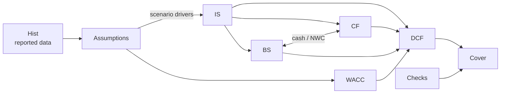

# Infosys Limited (NSE: INFY) — Three-Statement Model & DCF Valuation


A fully linked income statement, balance sheet and cash flow model for Infosys Limited, with a scenario-driven unlevered DCF, WACC build-up, three sensitivity grids and a dedicated integrity-check tab. Every reported figure is traced to Infosys's audited filings.

> **Valuation snapshot (base case, as of 23 October 2026)**
>
> | Implied value / share | Current price | Upside | WACC | Terminal growth | EV |
> | :---: | :---: | :---: | :---: | :---: | :---: |
> | **₹1,183** | ₹1,153.35 | **+2.5%** | 12.33% | 5.0% | ₹4,29,197 cr |
>
> Bear ₹952 (−17.5%) · Base ₹1,183 (+2.5%) · Bull ₹1,335 (+15.8%)

---

## Contents

- [Repository structure](#repository-structure)
- [Model architecture](#model-architecture)
- [Methodology](#methodology)
- [Key assumptions](#key-assumptions)
- [Results](#results)
- [Sensitivity analysis](#sensitivity-analysis)
- [Model integrity](#model-integrity)
- [How to use the model](#how-to-use-the-model)
- [Limitations](#limitations)
- [Sources](#sources)
- [Disclaimer](#disclaimer)

---

## Repository structure

```
infosys-financial-model/
├── infosys-financial-model.xlsx   # The model (10 tabs)
└── README.md                      # This file
```

## Model architecture

| Tab | Purpose |
| --- | --- |
| **Cover** | Live key outputs, model map, colour conventions, methodology notes and key risks |
| **Hist** | Reported Ind AS consolidated IS, BS and CF for FY2022A–FY2026A; Q1 FY27 results, FY27 guidance and post-balance-sheet items |
| **Assumptions** | Scenario selector (`D4`), Bear / Base / Bull driver blocks and common balance-sheet drivers |
| **IS** | Income statement — historical links plus driver-based forecast |
| **BS** | Balance sheet — working capital, fixed assets, goodwill, leases, equity roll-forward; cash from CF |
| **CF** | Indirect cash flow statement; closing cash feeds the BS |
| **WACC** | INR CAPM cost of equity, lease-based cost of debt, market-value weights |
| **DCF** | Unlevered FCF, terminal value, EV-to-equity bridge, roll-forward and three 5×5 sensitivity tables |
| **Checks** | 15 integrity checks rolled into a single master flag |
| **Sources** | Document reference for every reported and market input |



**Colour conventions:** blue font = hard-coded input · black = same-sheet formula · green = cross-sheet link · grey fill = editable assumption · teal fill = key output.

## Methodology

- **Revenue** = prior year × (1 + constant-currency growth) × (1 + FX translation effect), separating operating growth from INR movement.
- **EBIT margin** is the primary operating input (company definition, before other income). Other operating costs are the residual after employee costs and D&A.
- **Unlevered FCF** = EBIT × (1 − tax) + D&A − capex − new right-of-use lease additions − increase in NWC.
  - Leases are treated as debt-like consistently across WACC, UFCF and the bridge.
  - Stock-based compensation is treated as a real cost (not added back).
- **Discounting** from the 31-Mar-2026 balance-sheet date using the mid-year convention; perpetuity-growth terminal value.
- **Equity bridge** adds cash and current/non-current investments; deducts restricted cash, lease liabilities, NCI and acquisitions committed after the balance-sheet date (Optimum Healthcare IT, Stratus Global — ₹5,311 cr).
- **Roll-forward**: equity value per share is rolled to the valuation date at the cost of equity, less the ₹25 final dividend paid in June 2026.

## Key assumptions

| Driver (FY2027E → FY2031E) | Bear | Base | Bull |
| --- | --- | --- | --- |
| Constant-currency revenue growth | 1.5% → 4.0% | 2.5% → 6.0% → 5.5% | 3.0% → 8.0% → 7.5% |
| FX translation effect | 6.0% → 1.0% | 7.0% → 2.5% | 8.0% → 3.0% |
| EBIT margin | 20.0% → 19.5% | 21.0% → 21.3% | 21.5% → 22.0% |
| Capex % revenue | 1.8% | 1.6% | 1.5% |
| Receivable days | 76 | 72 | 70 |
| Effective tax rate | 28.5% | 27.5% | 26.5% |

FY27 guidance for reference: CC growth 1.5–3.0%, operating margin 20–22%.

| WACC input | Value |
| --- | --- |
| Risk-free rate (India 10Y G-sec) | 7.40% |
| Equity beta | 0.85 |
| Equity risk premium | 6.00% |
| Cost of equity | 12.50% |
| After-tax cost of debt (leases) | 3.63% |
| Equity / debt weights | 98.1% / 1.9% |
| **WACC** | **12.33%** |

## Results

| Base case (₹ crore) | FY2026A | FY2027E | FY2028E | FY2029E | FY2030E | FY2031E |
| --- | ---: | ---: | ---: | ---: | ---: | ---: |
| Revenue | 1,78,650 | 1,95,934 | 2,10,874 | 2,29,115 | 2,48,933 | 2,69,190 |
| EBIT margin | 20.9% | 21.0% | 21.0% | 21.2% | 21.3% | 21.3% |
| Net profit to owners | 29,440 | 31,602 | 33,958 | 37,455 | 41,094 | 44,678 |
| Diluted EPS (₹) | 71.46 | 77.98 | 83.79 | 92.42 | 101.40 | 110.24 |
| Unlevered FCF | – | 26,085 | 28,584 | 31,029 | 33,893 | 36,862 |

| Scenario | Value / share | vs ₹1,153.35 | Enterprise value | P/E on FY27E EPS |
| --- | ---: | ---: | ---: | ---: |
| Bear | ₹952 | −17.5% | ₹3,41,704 cr | 13.2× |
| **Base** | **₹1,183** | **+2.5%** | **₹4,29,197 cr** | **15.2×** |
| Bull | ₹1,335 | +15.8% | ₹4,87,133 cr | 16.3× |

Terminal value is ~73% of EV in the base case, implying 8.1× FY2031E EBITDA.

## Sensitivity analysis

Implied value per share (₹), WACC vs terminal growth — base case in bold:

| WACC \ g | 4.0% | 4.5% | 5.0% | 5.5% | 6.0% |
| --- | ---: | ---: | ---: | ---: | ---: |
| 11.33% | 1,215 | 1,282 | 1,359 | 1,450 | 1,557 |
| 11.83% | 1,141 | 1,199 | 1,264 | 1,340 | 1,429 |
| 12.33% | 1,077 | 1,126 | **1,183** | 1,247 | 1,322 |
| 12.83% | 1,019 | 1,062 | 1,111 | 1,167 | 1,230 |
| 13.33% | 968 | 1,006 | 1,049 | 1,097 | 1,151 |

The DCF tab also includes **CC growth vs EBIT margin** (±1 pp margin ≈ ±₹60/share; ±1 pp growth ≈ ±₹35/share) and **beta vs risk-free rate** grids.

## Model integrity

The **Checks** tab runs 15 tests (tolerance ±₹0.5 crore) and returns `✓ ALL CHECKS PASS` in all three scenarios:

- Balance sheet balances and CF closing cash ties to BS cash, FY2022A–FY2031E
- Historical PBT, total assets, total liabilities & equity and closing cash reconcile to reported figures
- Opening cash = prior-year closing cash; CF profit = IS profit; equity roll-forward closes
- DCF revenue = IS revenue; terminal growth < WACC; sensitivity centres = headline value
- Non-negative forecast cash and fixed assets; valid scenario selector

## How to use the model

1. Open `infosys-financial-model.xlsx` in **Excel 2021 or Microsoft 365** (the sensitivity grids use `LET`).
2. Set the scenario in **Assumptions!D4** — `1` Bear, `2` Base, `3` Bull. All statements, the DCF and the Cover update.
3. Edit grey-filled cells on **Assumptions** or **WACC** to test your own view.
4. Refresh the share price in **DCF!D7** and the valuation date in **DCF!D6** before relying on the output.
5. Confirm **Cover!C18** still reads `✓ ALL CHECKS PASS` after any change.

## Limitations

- No explicit revenue from the Optimum and Stratus acquisitions, although their cost is deducted in the bridge (≈ ₹13/share, conservative).
- 70% dividend payout with no buybacks builds surplus cash; Infosys's policy is to return ~85% of FCF over five years. This does not affect the DCF value.
- The share price and bond yield come from unofficial aggregators; beta, ERP and all forecast drivers are analyst assumptions.

## Sources

- [Infosys Form 6-K Ex. 99.3 — FY2026 results](https://www.sec.gov/Archives/edgar/data/0001067491/000106749126000014/exv99w03.htm)
- [Infosys Form 6-K Ex. 99.3 — FY2024 results](https://www.sec.gov/Archives/edgar/data/1067491/000106749124000014/exv99w03.htm)
- [Infosys Form 6-K Ex. 99.3 — FY2023 results](https://www.sec.gov/Archives/edgar/data/1067491/000106749123000025/exv99w03.htm)
- [Infosys IFRS-INR press release — Q1 FY27 (23 Jul 2026)](https://www.sec.gov/Archives/edgar/data/0001067491/000106749126000038/exv99w02.htm)
- [Infosys Q4 FY26 earnings call transcript](https://www.infosys.com/investors/reports-filings/quarterly-results/2025-2026/q4/documents/transcripts/earningscall.pdf)
- [Tickertape — Infosys share price](https://www.tickertape.in/stocks/infosys-INFY) (unofficial)
- [Trading Economics — India 10Y bond yield](https://tradingeconomics.com/india/government-bond-yield) (unofficial)

## Disclaimer

This model is an independent project built for learning purposes. It is not investment advice or a recommendation to buy or sell any security. Figures are in ₹ crore unless stated and may contain errors; verify against primary filings before use.

---

**Author:** Bishal · MBA, IIM Kozhikode
